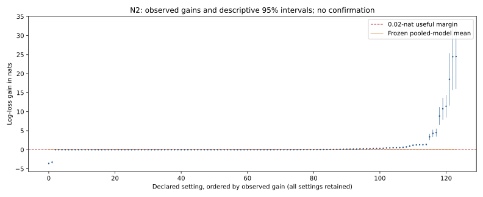

# N2: timing weights and a pooled-stopping limitation

Does weighting by response time improve preference recovery? N2's frozen pooled stopping rule stops the family, yet 48 of 120 nonstructural settings have observed pooled gains above 0.02 nats. The largest is 24.47776 nats, with a descriptive 95% interval of 15.99531–32.96020. Near-zero uncertainty in other settings dominates the pooled model. This is a constructed-method limitation and a descriptive gain pattern, not a confirmed benefit or evidence that timing never helps.

Two complete burn-ins cover 124 settings, 32 whole worlds per setting and 64 cases
per world: 253,952 cases. Four known structural controls stay exactly zero and are
excluded from the continuous-effect model. All scientific files replay; independent
reconstruction verifies primary scores, world means, intervals and the frozen card.
The earlier saturated-score failure remains retained; the numerical repair changes
neither generated cases nor their predictions.

The largest observed gain occurs with 128 records, high choice precision, a
three-quarter mixed-strategy share and the middle timing slope. The displayed
interval is a normal approximation to inverse-variance pooled whole-world bootstrap
estimates; it is descriptive and selected after discovery, not a confirmation.
The frozen card reports zero posterior probability above the useful margin and
stops. This is its procedural outcome, not a finding that all observed gains are
small. Forty-eight nonstructural point estimates exceed that margin.

The smallest pooled standard error is about 1.04e-158; seven are below 1e-100.
A separate retained-data audit integrates the **same Gaussian model and priors**
on nonuniform grids of 4,098 and 8,194 nodes with proper integration widths.
Both again collapse toward zero. This does not establish a simple quadrature
endpoint bug. It raises a model/uncertainty question for theory review: near-zero
error cells dominate pooling across this heterogeneous family. Calibration remains
qualified to its declared simulation grid. No prior, variance floor, margin,
selection or machine card was changed, and no new observations were generated.

The broad universal predictions are not established by this result. Positive and
negative gains coexist; the complete curve and reader/diagnosticity/calibration
summaries remain visible. The noisy-class comparisons cannot establish a claim
about whether noise exists in people, and unavailable rank diagnostics are retained.
Secondary intervals are replay-verified; this review does not independently
reimplement every secondary statistic or retrospectively promote a favorable cell.

Blue points show observed gains and descriptive intervals; orange shows the frozen
pooled-model mean. The dashed line is the 0.02-nat useful margin. All 124 settings
remain in the [review record](../../../results/v23/n2-decision-review/README.md).
