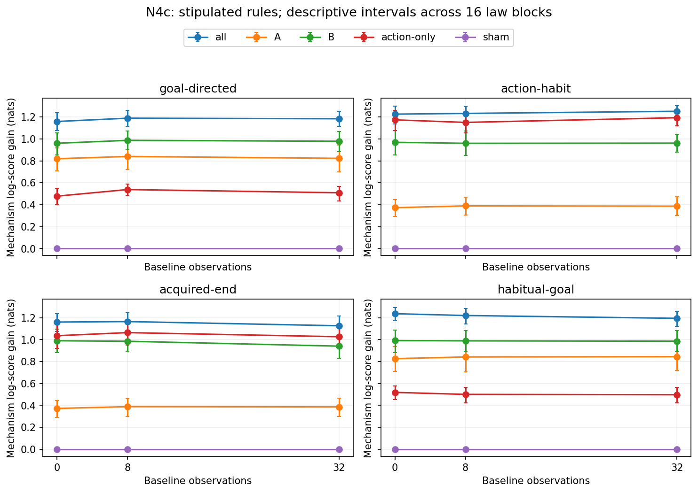

# N4c: complete conditional devaluation study

Training clarification: [fresh-minibatch law weighting](FRESH_RIVAL_QUALIFICATION.md). All laws were represented, with unequal weights; exact primary results and saved forecasts remain unchanged.

Can need satisfaction and alternative means distinguish control rules that look identical in ordinary behavior? In N4c's twelve constructed settings, the combined probes improve the true-mechanism log score by 1.127–1.252 nats. Habit cases improve by 1.226–1.252 nats; baseline/sham observations remain aliased. Removing observed goal commitments from probes leaves goal-directed and habitual-goal rules exactly aliased. All 12,288 cases, six rival forecasts, complete replay and 192 whole-world intervals verify. These are stipulated mechanisms, miniature — architecture untested; this does not establish how ends are learned or how humans behave.

The [predeclared protocol](N4C_PROTOCOL.md) crossed four rules with 0, 8 and 32
baseline observations. Each setting has sixteen independent law blocks and 64
cases per block. Reset probes test the original need, candidate end and alternative
means; all responses were forecast before observation. The prior over mechanisms
is uniform. More aliased baseline history informs response reliability, not the
mechanism's identity. The fourth arm includes an explicitly observed goal-menu
commitment; this is not an inferred mental report.

Each row below gives one constructed rule and baseline-history length. Gain is
the reduction in true-mechanism log loss, in nats. Intervals are descriptive 95%
bootstrap intervals over whole law blocks, not cases or multiplicity-adjusted claims.

| Control rule | Baseline records | Gain (nats) | Descriptive 95% interval |
|---|---:|---:|---|
| goal-directed | 0 | 1.15876 | 1.07572–1.23958 |
| goal-directed | 8 | 1.18899 | 1.11667–1.25974 |
| goal-directed | 32 | 1.18389 | 1.11526–1.25136 |
| action-habit | 0 | 1.22585 | 1.13711–1.30068 |
| action-habit | 8 | 1.23233 | 1.15973–1.29363 |
| action-habit | 32 | 1.25198 | 1.19406–1.30455 |
| acquired-end | 0 | 1.16051 | 1.07409–1.23747 |
| acquired-end | 8 | 1.16524 | 1.07604–1.24745 |
| acquired-end | 32 | 1.12681 | 1.03693–1.21547 |
| habitual-goal | 0 | 1.23687 | 1.17179–1.29197 |
| habitual-goal | 8 | 1.22037 | 1.14231–1.28622 |
| habitual-goal | 32 | 1.19470 | 1.12051–1.25791 |

Probe A alone leaves action-habit and acquired-end response laws identical; its
positive information gain for those cases comes from excluding other rules.
The B probes and available alternative means supply the additional distinction.
The action-only ablation masks probe goal commitments but retains the shared
baseline observations. It cannot distinguish goal-directed from habitual-goal
control under these laws. A positive information gain is not perfect classification.

All six fixed/fresh direct-reader comparisons are retained as forecasts of observed
joint responses. They are not classifiers trained on hidden mechanism labels.
The primary is a conditional identifiability diagnostic; no model, setting or
significance result is promoted into V23 confirmation.

[Complete primary, ablation and forecast curves](../../../results/v23/n4c-complete/SUMMARY.json),
[validation receipt](../../../results/v23/n4c-complete/VALIDITY.json),
[independent reconstruction](../../../results/v23/n4c-complete/RECONSTRUCTION.json)
and [full replay index](../../../results/v23/n4c-complete/REPLAY.json) retain the evidence.
All public, evaluator, ledger, posterior and prediction streams remain in the
immutable local packet, bound by the replay index. Production took 375.42
CPU-seconds including replay; the independent controller review is charged separately.

The scientific limitation is structural: the four response rules and their noise
are supplied, and no acquisition process is simulated. This validates recovery
under those assumptions, not that the assumptions describe people. N4b remains
unchanged and main N4's capped profile remains an incomplete resource result.
N4c is complete and receives no refill. The later [twin profile review](TWIN_PROFILE_REPORT.md) records three failed profiles and their separate unresolved requirements.

