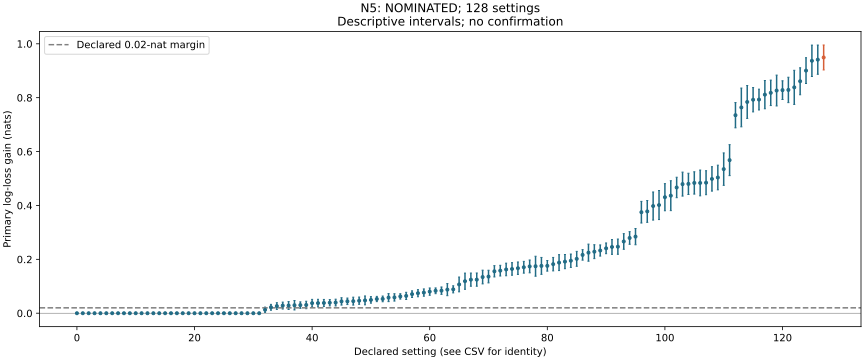

# N5: reviewed discovery disposition

How much does forecasting from the reader’s own policy cost? N5 nominates prior-shift calibration at the largest anchor-shaped bias with no personal records: log-loss gain is 0.94929 nats, with a descriptive 95% interval of 0.90291–0.99567. Both full burn-ins verify all 128 settings and 262,144 cases. This is a constructed-method discovery with supplied population rates; the approximate hierarchical rival is not an exact ceiling, and no human benefit is established.

The reader’s own four-action policy is shifted from supplied population rates. Calibration multiplies its probabilities by the population-to-own rate ratio. With correct quality sensitivity this algebraically recovers the base-rate predictor; it does not discover population rates or personal values. With absent quality sensitivity it cannot recover the missing quality feature. The nominated setting has offset two, anchor-shaped displacement, concentration twenty, no records and absent quality sensitivity.

The table separates the registered predictions from the observed diagnostic counts. Setting comparisons use equally weighted batch summaries; the nomination curve uses the frozen inverse-variance pooled whole-world rule.

| Prediction or control | Disposition |
|---|---|
| No bias gives no calibration gain | All 32 structural-zero settings pass. |
| Large bias without history loses more than 0.02 nats to base rates | 16/16 settings. |
| The same region contains a class observed at least 20% but never predicted top | 16/16 settings. |
| Calibration recovers at least 75% of the base-rate gap in that region | 15/16 settings; the universal prediction fails. Quality misspecification remains explicit. |

All reader losses, half-Brier scores, class biases, named-class frequencies, personal-history curves and quadrature diagnostics remain in the complete records. Adjustment and partial pooling are descriptive comparators; neither finite point ordering nor the approximate hierarchical calculation establishes universal dominance. The proposed case where the population model has incorrect quality sensitivity was not implemented: its quality model is correct throughout, so the claimed special advantage in that case is untested. The primary algebraic calibration contrast does not depend on the approximate hierarchical rival.

With eight or thirty-two personal records, partial pooling has lower mean log loss than calibrated projection in all 64 settings. Adjusted projection beats partial pooling in none of those 64 settings. These are descriptive point comparisons across the two batches, not simultaneous significance claims. They support retaining personal evidence after base-rate correction; they do not establish the unexecuted population-quality-misspecification prediction.

The committed Sounding Line aggregate is an action-rate anchor, not empirical validation of these Dirichlet makers. No exact-headroom claim is made from approximate quadrature. Both direct-fit seeds and label budgets, their validation stopping, and all raw products remain retained.

The curve shows primary log-loss gain and descriptive 95% intervals. Every declared setting remains in the CSV and JSON, including structural zeros or unavailable targets. These intervals do not supply multiplicity-controlled confirmation. Calibration counts, source archives, frozen fits, complete raw hashes, world identities, machine-card dependencies and distinct replay owners were checked. No confirmation order has been frozen.

[Primary review and complete diagnostics](../../../results/v23/n5-decision-review/README.md).
