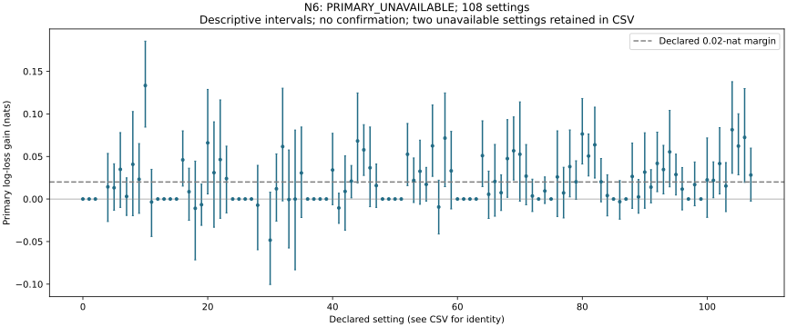

# N6: reviewed discovery disposition

Does modeling everyone while gating uptake improve prediction? N6 has no selectable family result: two of 108 settings contain one world with no low-warmth, low-competence targets. All 110,592 cases, finite forecasts, raw scores and full replay verify, but the declared whole-world primary remains unavailable. This is an inconclusive constructed-mechanism study, not a null; no world is dropped and no confirmation is admitted.

The low-low target is warmth zero and competence zero. Setting N6-0003 has no eligible target in world 9; setting N6-0029 has none in world 13 (zero-based world identifiers). All predictions in both settings are finite. The failure is the empty conditional denominator, not empty predictive support. The guard correctly prevents finite family selection when any declared primary world is unavailable.

The complete curve retains both unavailable rows and the remaining 106 finite diagnostic rows. Those finite rows are not a selected subset for nomination. Warmth-by-competence losses, unwanted purpose uptake, useful and failed technique, false withdrawal, update cost and total payoff remain available separately. All secondary summaries and intervals are independently rebuilt; uptake counts are also reconstructed from retained paths. The finite payoff policy’s independent Bellman checks remain bound to the original/replay evidence.

The four scientific predictions—positive-stakes forecast gain, separable/coupled uptake behavior, false-withdrawal cost and zero-stakes payoff parity—remain diagnostic rather than an accepted family conclusion. No extra sample, dropped world or changed target was used to manufacture a finite primary. Goal-bearing uptake is a constructed payoff mechanism, not evidence of physical execution or human CARE/disgust.

The curve shows primary log-loss gain and descriptive 95% intervals. Every declared setting remains in the CSV and JSON, including structural zeros or unavailable targets. These intervals do not supply multiplicity-controlled confirmation. Calibration counts, source archives, frozen fits, complete raw hashes, world identities, machine-card dependencies and distinct replay owners were checked. No confirmation order has been frozen.

[Primary review and complete diagnostics](../../../results/v23/n6-decision-review/README.md).
