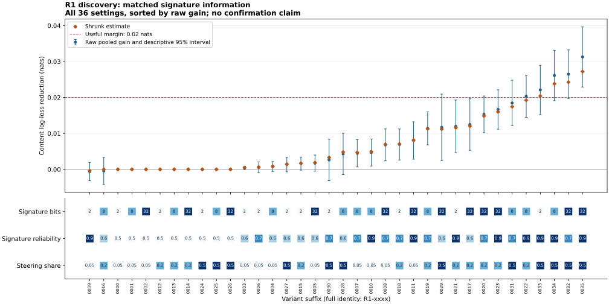

# R1: matched steering-signature information

Does a steering signature help when both readers can represent steering? The repaired neutral-signature control gives zero gain in all nine settings. The strongest tested signature is nominated after three batches: its estimated content-loss reduction is 0.03127 nats, with a descriptive 95% interval of 0.02291–0.03962. The broader prediction fails: four of eight predicted strong settings remain below the 0.02-nat margin in point estimate. This is a constructed-method discovery, not confirmation or evidence about people.

The curve retains parked variants, negative estimates and all nine exact neutral
controls. Intervals use inverse-variance pooling of independently bootstrapped
whole-world batch estimates, with a normal approximation. They are descriptive
after adaptive selection, not simultaneous confidence claims. The [faceted heat
map](../../../results/v23/r1-decision-3-review-2/HEATMAP.svg) shows the same raw
estimates across all three design axes.

The nominated setting has steering prevalence 0.5, signature reliability 0.9 and
32 bits. Its shrunk estimate is 0.02721 nats. The probability that the best shrunk
setting exceeds the 0.02-nat useful margin rose from 0.73292 to 0.80895 to 0.96532.
The frozen nomination boundary is 0.90. Two complete 16-world burn-ins cover all
36 settings; the third batch covers nine survivors with 48 worlds each, always
64 cases per world. That is 101,376 cases, each replayed in a distinct process.

## Predictions and separate contrasts

Each row gives the original prediction and its discovery disposition. A positive
signature value means that seeing selection bits lowers content log loss relative
to the same steering-capable reader with those bits masked.

| Prediction | Disposition |
|---|---|
| Neutral signatures have zero information value | Supported as an exact instrument identity in all nine settings. No positive standard error was invented for these controls. |
| Reliability at least 0.7, at least eight bits and prevalence at least 0.2 exceed 0.02 nats | Not established across the predicted region: four of eight point estimates are below the margin. Only the nominated setting has its descriptive lower interval above it. |
| Skepticism remains useful without a signature at prevalence at least 0.2 | Positive point estimates in all 24 settings: 0.00263–0.00760 nats at prevalence 0.2 and 0.02093–0.04773 at prevalence 0.5. This contrasts the missing-process reader with the correctly specified masked reader. It is a separate hypothesis-space comparison. |
| At prevalence 0.05, false skepticism harms informing sources and signatures shrink that cost | Unresolved as a general claim. Masked-reader extra loss on informing sources ranges from −0.00040 to 0.00131 nats; visible-signature extra loss ranges from −0.00129 to 0.00246. The signs and reductions are not uniform. |

For the nominated setting, equal-world pooling across its 80 discovery worlds
gives a signature gain of 0.03055 nats (bootstrap interval 0.02156–0.03914).
This is a transparent secondary aggregation, not a replacement for the calibrated
inverse-variance decision. Skepticism without selection bits gives 0.03557 nats
(0.02744–0.04375). That overall benefit includes a cost of 0.03169 nats on informing
sources and a benefit of 0.10088 on steering sources. Visible strong signatures
remove the informing-source cost to numerical precision in this setting.

## Direct rivals, diagnostics and limits

All twelve direct fits stopped on validation. At the nominated setting, both
fixed-label visible fits at 2,048 and 8,192 labels leave more than 0.02 nats of
excess loss relative to the equally informed exact reader, including their lower
intervals. Both fresh-law visible fits instead have upper intervals below 0.02:
0.01061 and 0.01704 nats. Every masked fit also has its upper interval below 0.02
against the masked exact reader. The declared matched-information gate therefore
does not establish universal exact-reader superiority. Fresh-law training has an
explicit extra-label privilege; it is not a label-matched comparison.

[Every reader and stratum](../../../results/v23/r1-decision-3-review-2/READER_STRATUM_SCORES.csv)
includes content log loss, half-Brier probability error and accuracy, with
whole-world uncertainty. Goal zero denotes informing and goal one steering.
[Secondary scores](../../../results/v23/r1-decision-3-review-2/SECONDARY_SCORES.csv)
retain content, purpose and technique measurements from every batch. They are
forecast scores, not physical execution or proof of historical process identity.
Stratum intervals average only worlds containing that stratum; their denominators
are explicit. No outcome or latent source goal is supplied to a direct reader.

Independent posterior checks ran on every original and replay case. This review
independently rebuilt proper scores, whole-world gains, bootstrap intervals and
all three frozen decisions from retained probabilities and evaluator sidecars.
The largest score discrepancy was 1.11 × 10⁻¹⁶. Full replays match 238, 219 and 57
scientific files; only separately recorded CPU timing is excluded. Raw hash
indexes, source archives, fit hashes and distinct original/replay process owners
were rechecked. Canonical ledger/native forecasts and truth separation passed
the source-bound pipeline checks. [Review and bindings](../../../results/v23/r1-decision-3-review-2/REVIEW.json),
[raw hashes](../../../results/v23/r1-decision-3-review-2/RAW_HASH_INDEX.json).

The three scientific packets charged 6,433.844 CPU seconds including replay.
Review/render helpers are charged separately. The initial batch startup failure
and first review-helper scoring-key failure remain retained; neither produced
an accepted scientific result. No valid science was rerun to repair that helper.

The accepted calibration was rechecked without resampling: 725 of 13,181 strong
families were wrongly stopped and 18 of 6,247 null families nominated, with the
same pooled qualification and 33 stress settings retained. This discovery awaits
a frozen confirmation order, a variant-specific direct fit and a source-bound
reserved-world packet. A nomination neither confirms the primary contrast nor
authorizes replacing it with the refitted direct comparison. Negative gains must
remain raw; independent balanced law blocks and the analytic support bound govern
the later test. R2 remains active independently, and unfinished families are not
scientific nulls.
