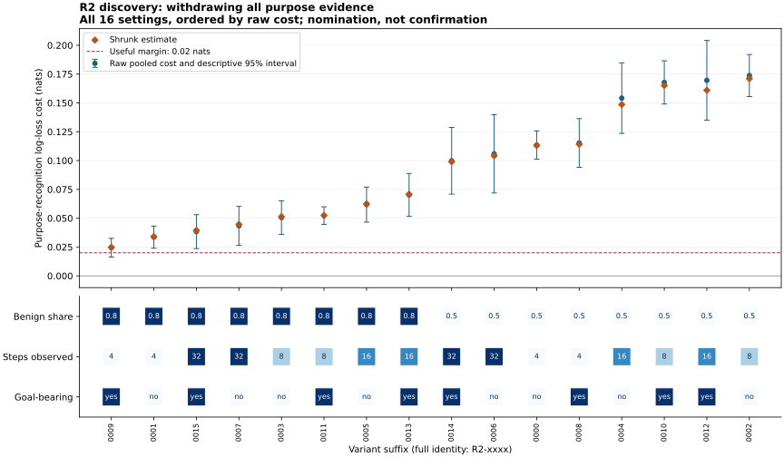

# R2: the recognition cost of withdrawing every purpose channel

Does withdrawing every purpose-diagnostic channel impair recognition? R2 finds a cost above 0.02 nats in all eight tested 16- and 32-step settings. The strongest setting is nominated after two batches at 0.17372 nats, with a descriptive 95% interval of 0.15550–0.19195. Benign false alarms carry the accuracy cost; release does not uniformly preserve protection. This is a constructed-method discovery, not confirmation or evidence about people.

The primary comparison is purpose log loss under withdrawal of every diagnostic
channel, with residual precision 0.05 and firing threshold 0.7, minus loss with
no gate. A positive value means withdrawal makes the forecast worse. It is not
a mechanism reader's gain over a direct reader. The [heat map](../../../results/v23/r2-decision-2-review/HEATMAP.svg)
retains both procedure types, both benign shares and all four prefix lengths.

Two complete 16-world batches cover all 16 settings, with 64 cases per world:
32,768 cases. Each batch contains all 16 declared reliability laws. The nominated
setting has separable procedures, eight observed steps and benign share 0.5.
Its shrunk estimate is 0.17098 nats. The frozen rule requires both burn-ins before
nomination; the selected tail probability is numerically one at both looks
(stored final value 1 + 2.7 × 10⁻¹⁵ from quadrature roundoff). The calibrated
0.90 nomination boundary and original numerical bytes remain unchanged.

The eight longer-prefix estimates range from 0.03838 to 0.16958 nats, and every
descriptive lower bound exceeds 0.02. Across all 16 settings, 15 lower bounds
exceed the margin. Primary intervals use inverse-variance pooling of whole-world
batch bootstrap estimates and a normal approximation. They are descriptive
after selection, not simultaneous intervals or confirmation.

## Original predictions and their dispositions

Each row states a prediction and what the retained discovery evidence supports.
Memory change means absolute movement from the initial probability 0.5; it is
distinct from recognition accuracy, probability loss and physical execution.

| Prediction | Disposition |
|---|---|
| Recognition cost exceeds 0.02 nats at 16 and 32 steps | Supported descriptively in all eight specified settings, including their lower intervals. The maximum is at eight steps, so the effect is not monotone in stream length. |
| False alarms impose the accuracy cost on benign makers, while truly flagged makers mainly lose confidence | Supported for the primary policy. At 16/32 steps benign accuracy losses range from 1.38 to 23.68 percentage points; flagged accuracy changes range from zero to a 1.09-point improvement. Flagged log loss nevertheless increases by 0.06311–0.11838 nats. This is an empirical pattern, not the unproved sequential identity in the original specification. |
| Release at residual precision at least 0.2 recovers most benign cost while preserving protection within 0.02 | Not established generally. Higher residual precision and release are separate changes. Matched release/no-release comparisons retain losses in protection and sometimes increased classification error. The full policy grid is retained. |
| Withdrawing all channels protects at least as much as withdrawing content at matched technique | Qualified. For the primary policy, purpose-memory change is lower in every 16/32-step setting and technique accuracy matches, but strict value-memory dominance fails in some strata by small amounts. The broader fixed-mixture grid does not show universal dominance. |

At the nominated setting, equal-world pooling gives 0.17193 nats of recognition
cost (bootstrap interval 0.15276–0.19214), a secondary aggregation rather than a
replacement for the calibrated decision. Benign makers lose 20.10 percentage
points of accuracy (descriptive interval 16.28–23.93), while flagged makers gain
3.26 points. Their respective log-loss costs are 0.24073 and 0.10225 nats.
Among benign cases, 247 of 1,025 trigger withdrawal; the equal-world false-alarm
rate is 24.02%. The 247 fired cases have an 87.43-point conditional accuracy loss.
That conditional stratum is selected by the policy and is not a randomized
causal effect. Both purpose and value memory remain unchanged at eight steps
because those direct channels have not yet opened; this is not protection from
encountered content.

For a longer-stream example, consider separable procedures, 16 steps and benign
share 0.5. At residual precision 0.2 and threshold 0.7, adding release reduces
benign log-loss cost by 0.01521 nats (0.00868–0.02174). But it increases accuracy
cost by 1.42 percentage points and increases purpose/value memory change by
0.05169/0.04313, with lower intervals 0.04226/0.03452. Protection therefore does
not stay within the 0.02 margin in this comparison. This example is a prediction
diagnostic, not a selected new optimum.

The same 16-step setting provides a matched-technique comparison of the two pure
withdrawal policies at precision 0.05 and threshold 0.7. Withdrawing every
channel instead of content alone leaves technique accuracy unchanged, reduces
overall purpose-memory change by 0.00809, and adds 0.13598 nats of recognition
loss. Overall value-memory change differs by −0.000070, with its interval
including zero; benign value-memory change instead increases by 0.000032.
Small reversals remain visible rather than being rounded into exact dominance.

## Complete diagnostics and direct rivals

All 25 sequential policies are retained, including no gate, procedure-only,
early guard, content withdrawal, and the 21 withdrawal-all settings. The
[policy/stratum table](../../../results/v23/r2-decision-2-review/POLICY_STRATA.csv.gz)
covers all, benign, flagged, fired and non-fired cases and their intersections.
It includes every head's log loss, half-Brier probability error, accuracy and
memory change, plus false alarms and releases. Empty strata are counted without
invented scores. Intervals in this large diagnostic table use paired whole-world
normal approximations over nonempty worlds; unlike the primary bootstrap,
normal rate intervals can extend outside zero to one. These are unadjusted
descriptive intervals.

The [complete fixed-mixture table](../../../results/v23/r2-decision-2-review/MATCHED_TECHNIQUE.csv.gz)
crosses weights 0, 0.25, 0.5, 0.75 and 1 on each withdrawal policy, with the rest
assigned to no gate. All 25,200 policy/weight/stratum comparisons remain; 24,186
nonidentical rows meet the 0.02 mean technique-accuracy tolerance, alongside
1,008 identical no-gate controls. Six rows fail the mean match. This is a
descriptive mean-matching rule, not an equivalence test or independent evidence
from 25,200 experiments. Mixtures average policy outcomes, not probabilities
before scoring.

All six direct fits stopped on validation. At the nominated setting, both
8,192-label fixed fits have upper excess-loss intervals below 0.02 nats
(0.01613 and 0.01127), as do both fresh-law fits (0.01174 and 0.01475).
They meet the declared parity gate against the equally informed ungated exact
reader. The 2,048-label pair is unresolved. There is no general exact-reader
superiority claim, and the extra labels generated by fresh-law training remain
an explicit privilege. Direct readers receive the observed streams and declared
design settings, never the planted purpose, reliability law or target.

## Verification and remaining limits

Independent posterior reconstruction and canonical-ledger/native agreement ran
on every original and replay case. This review rebuilt every saved proper score,
primary whole-world gain, bootstrap interval and frozen family decision. It also
performed 48,000 independent secondary-summary arithmetic checks from the retained
heads and trajectories. The maximum primary score discrepancy is 1.11 × 10⁻¹⁶.
Full fresh-process replays match 109 and 99 scientific files, with distinct original
and replay process owners; only separately recorded timing is excluded. Source
archive, fit and raw-file hashes were rechecked. No valid science was repeated.

[Review bindings](../../../results/v23/r2-decision-2-review/REVIEW.json),
[raw scientific hashes](../../../results/v23/r2-decision-2-review/RAW_HASH_INDEX.json),
[secondary verification](../../../results/v23/r2-decision-2-review/POLICY_REVIEW.json)
and [retained review-artifact index](../../../results/v23/r2-decision-2-review/REVIEW_RAW_INDEX.json)
record the coverage. Complete per-world review records remain locally retained;
portable compressed tables decompress to their indexed original hashes.

The two scientific packets charged 15,997.015625 CPU seconds including full
replay. Review, rendering, failed engineering fixtures and services are charged
separately. Calibration was independently rechecked without resampling: 725 of
13,181 strong families were wrongly stopped, and 18 of 6,247 null families were
nominated; all 33 stress-setting qualifications remain.

This finite sequential construction neither models physical procedure execution
nor establishes a human withdrawal mechanism. The nomination awaits the complete
frozen confirmation order, a variant-specific direct refit, reserved worlds,
analytic raw-gain support and independent balanced law blocks. Negative gains
must remain raw. R4 continues under its existing source and budget; unbuilt N
pipelines and twins remain unexecuted scope, not scientific nulls.
