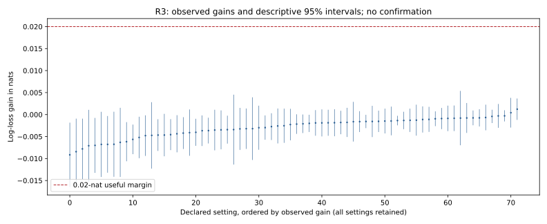

# R3: choice-independent labels do not earn extra weight

Do choice-independent cost labels improve forecasts when used as weights? R3 stops below the useful margin after two verified burn-ins. In all 24 irrelevant-label settings, observed pooled gains are negative, ranging from −0.00915 to −0.00029 nats. All 72 settings and 147,456 cases replay. This supports the predicted lack of useful weighting benefit in this construction; it is not a universal claim about effort or human behavior.

Two full burn-ins retain 32 whole worlds per setting and 64 cases per world.
The first recovered batch includes its retained original parts; its full scientific
cost is 17,979.359375 CPU seconds, not only the recovery's cost. The second costs
18,546.75 CPU seconds. Independent score/interval reconstruction, complete raw
coverage, frozen source/fit bindings, distinct replay owners and the calibrated
terminal card pass. All failed original attempts remain retained and charged.

This table describes the preregistered predictions using equal-batch means of
the replay-verified secondary summaries. Counts are design settings, not independent
discoveries; these secondary intervals are not independently reimplemented here.

| Prediction | Descriptive disposition |
|---|---|
| Irrelevant labels add no useful forecast gain | All 24 point gains are negative; frozen stop below margin. |
| Irrelevant weighting reduces interval coverage | 24 of 24 settings have lower coverage. |
| Generic tempering reproduces at least half the relevant-cost narrowing | 24 of 24 relevant-cost settings where effort weighting narrows. |
| True cost-role probability reaches 0.9 by 32 records | 0 of 36 settings with 32 or 128 records meet the point target. |
| Role inference matches true-role loss at 128 records | 18 of 18 lie within the 0.02-nat margin descriptively. |
| Wrongly assuming costs enter loses more than the margin | 12 of 12 irrelevant-label settings with at least 32 records. |

The role-identification and coverage predictions must be read with these counts;
the terminal primary does not establish all secondary predictions. The matched
tempering comparison separates generic sharpening from evidence about effort.
Direct rivals retain their training and information qualifications. No nomination,
reserved confirmation or human-utility conclusion follows.

The curve retains all 72 settings. Only the 24 irrelevant-label settings are eligible
for the declared primary selection; the other cost roles are diagnostics. Intervals
are descriptive normal approximations to inverse-variance pooled whole-world
bootstrap estimates. [Complete review](../../../results/v23/r3-decision-review/README.md).
