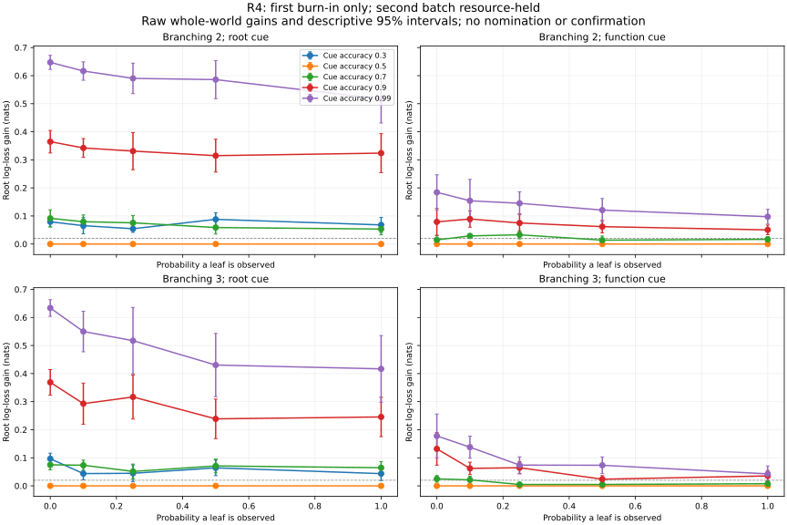

# R4 first burn-in and resource boundary

Does a root or function cue improve root recovery beyond leaf evidence? R4’s first burn-in verifies all 90 settings and 92,160 cases, but the mandatory second burn-in is resource-held. The first packet used 3.216 CPU hours; the conservative successor estimate is 4.824 hours, above the four-hour packet cap. No family nomination or null result is accepted. This is a constructed-method checkpoint, not confirmation or evidence about people.

## Retained evidence

The question is whether an observed title or function cue adds root information to
observed leaves in a depth-four binary-state tree. The completed batch covers
16 coefficient worlds and 64 cases per world in every setting. The 16 supplied
transition laws span child-parent agreement from 0.60 to 0.98. Branching is two
or three, leaf accuracy is 0.9, and the root or depth-one cue has the declared
reliability. A misleading-cue arm compares a reader fixed at 0.9 against the
actual 0.3 cue and a reader that averages possible cue reliabilities.

All 20 neutral-cue settings have exactly zero primary gain. In the
24 predeclared high-reliability, low-coverage settings,
24 point estimates and
24 descriptive lower bounds exceed the
0.02-nat margin. The largest first-batch estimate is 0.64720 nats (descriptive 95% interval 0.62222–0.67218), for a
0.99-reliable root cue, no observed leaves and branching two. This is the
best observed setting, **not a nomination**: the frozen rule requires both
complete burn-ins before selection can stop the family.

The curve plots bottom-up root log loss minus joint root log loss; larger values
mean the cue improves prediction. Every grid setting remains in the CSV and JSON,
including the 20 structural zeros and 10 misleading-cue settings. Coverage is
the probability that a leaf is observed, not a fixed observed-leaf count.

## Diagnostics and prediction status

The rows distinguish exact controls from descriptive predictions. No family-level
confirmation or general architectural conclusion follows from this one batch.

| Question | First-batch disposition |
|---|---|
| Neutral cue adds no information | All 20 primary structural zeros retained; complete node probabilities also agree within numerical precision. |
| Top-down equals joint with a root cue and no leaves | Whole-node identity passes, independently checked on retained forecasts. |
| Strong cues help at low coverage | 24/24 means exceed 0.02; 24/24 descriptive lower bounds do. Second burn-in remains missing. |
| Function cue preferentially helps its subtree | 28/30 matched-design point comparisons favor the function cue in that subtree. These are separate generated samples; no paired-case or simultaneous-significance claim. |
| Fixed trust is harmful when cue accuracy is 0.3 | 10/10 fixed-trust point excesses exceed 0.02 relative to the known-reliability joint reader. The reliability mixture is under half that excess in 10/10 settings. The explicit comparator and all values are retained. |
| Direct-reader headroom | Both-fit convergence/parity/headroom states remain in the complete diagnostics. No general advantage over a trained direct reader is asserted. |

Node forecasts are scored separately at each depth and inside/outside the cued
function subtree. With no leaf evidence, information attenuation conditional on
one law follows its root-to-node channel. Averaging the 16 laws requires averaging
their depth-specific powers; substituting the power of their mean is not the
same operation. Marginal node accuracy does not establish recovery of a unique
historical tree state.

## Verification, costs and limits

Independent review reconstructs every retained proper score, all primary
whole-world gains and bootstrap intervals, the calibrated burn-in decision and
all saved depth summaries. Maximum score error is 1.12e-16; maximum depth-summary
error is 2.78e-17. The original and replay ran in distinct processes and match
all 553 scientific files, including public observations, isolated truth, canonical
ledgers, posteriors, forecasts, frozen fits and training records. CPU timing is
the only replay exclusion. Source archive, raw index and dependency bytes were
rechecked. Calibration counts and decisions were reconstructed without resampling.

The measured packet cost is 11,577.234375 CPU seconds. The frozen continuation
multiplier produces 17,365.8515625 seconds for the next full burn-in, exceeding
the 14,400-second packet cap. The earlier 9,312-second reservation was a pilot
projection, not authority to waive this measured boundary. No successor was
launched and no scoring or survival criterion changed. R1/R2 nominations remain
separate; reserved confirmation worlds remain untouched.

The review helper initially copied the best setting into a field named
“nominated” even though its decision was burn-in. That report-only metadata was
corrected, the original retained locally, and the helper now emits no nomination
until the decision actually nominates. Numerical source and machine card were
unchanged. Visual review also corrected inconsistent colors between chart panels.

This finite constructed method uses supplied channel families and known cue
reliability for the exact reader. The intervals are descriptive and the family is
incomplete; the curve does not establish multiplicity-controlled discoveries,
human intent or transfer to an untested architecture.

[Portable review and diagnostics](../../../results/v23/r4-burnin-1-review/README.md).
