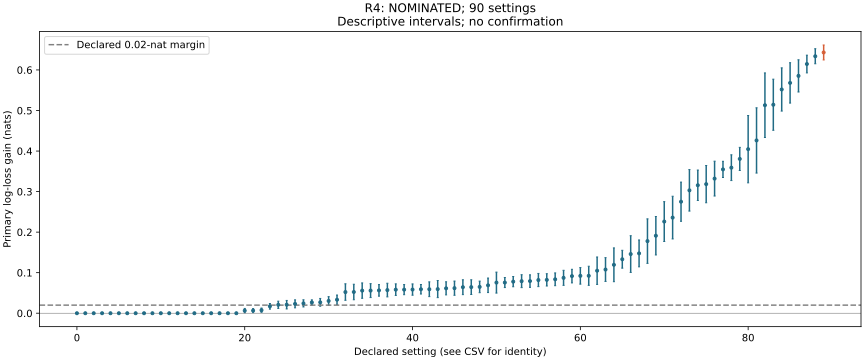

# R4: reviewed discovery disposition

Does a root or function cue improve root recovery beyond leaf evidence? R4 nominates a 0.99-reliable root cue with no observed leaves after two complete burn-ins: root log-loss gain is 0.64312 nats, with a descriptive 95% interval of 0.62467–0.66157. All 90 settings and 184,320 cases pass reconstruction and full replay; the 20 neutral-cue settings remain exact zeros. This is a constructed-method discovery, not confirmation or evidence about people.

The two batches contain 32 whole worlds per setting and 64 cases per world. The second logical batch comprises four disjoint four-world parts, each with original and distinct-process replay. All parts are required; the assembled parent is not an extra scientist. The earlier measured packet-cap hold was resolved through the authorized partition method, with unchanged worlds, grids, fits and criteria. The [first-burn-in report](R4_FIRST_BURNIN_REPORT.md) remains historical provenance.

The table gives the declared predictions and descriptive dispositions. Counts refer to settings or matched design comparisons, not independent discoveries.

| Prediction | Disposition |
|---|---|
| Strong cue at low leaf coverage exceeds 0.02 nats | 24/24 means and 24/24 descriptive lower bounds exceed the margin. |
| Full leaf coverage reduces cue value at branching three | 4/4 matched point comparisons favor the no-leaf cue gain. |
| Function cue helps its own subtree more | 28/30 point comparisons favor the function cue; these are different generated cases, not paired-case tests. |
| Fixed trust in misleading cues costs more than the margin | 10/10 settings; the reliability mixture is below half the excess in 10/10. |
| Neutral cues and no-leaf root-cue identity | Exact zero controls and top-down/joint node identities pass independent checks. |

The universal function-subtree prediction fails in two of thirty point comparisons. Root log loss, node depth, function-subtree and outside-subtree diagnostics remain separate. First-batch node reconstruction is reused under its matching completion hash; all second-batch node scores and intervals are freshly reconstructed. Direct-reader fit and headroom records remain in the full diagnostics; the primary comparison is against bottom-up inference, not a general superiority claim over trained direct readers. Supplied channel families and known cue reliability constrain interpretation.

The curve shows primary log-loss gain and descriptive 95% intervals. Every declared setting remains in the CSV and JSON, including structural zeros or unavailable targets. These intervals do not supply multiplicity-controlled confirmation. Calibration counts, source archives, frozen fits, complete raw hashes, world identities, machine-card dependencies and distinct replay owners were checked. No confirmation order has been frozen.

[Primary review and complete diagnostics](../../../results/v23/r4-decision-review/README.md).
